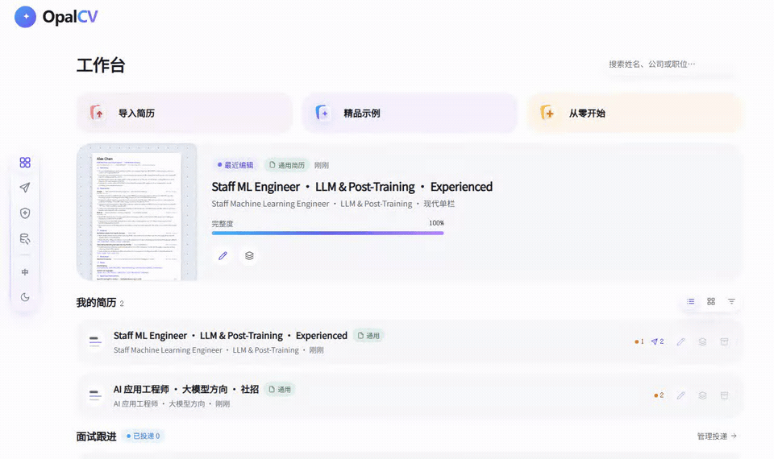
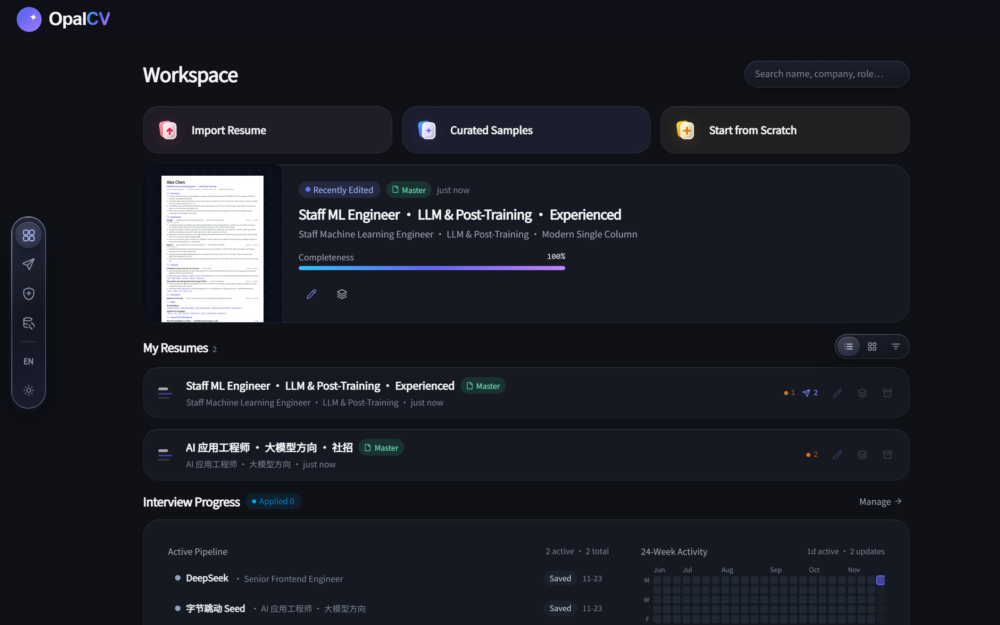
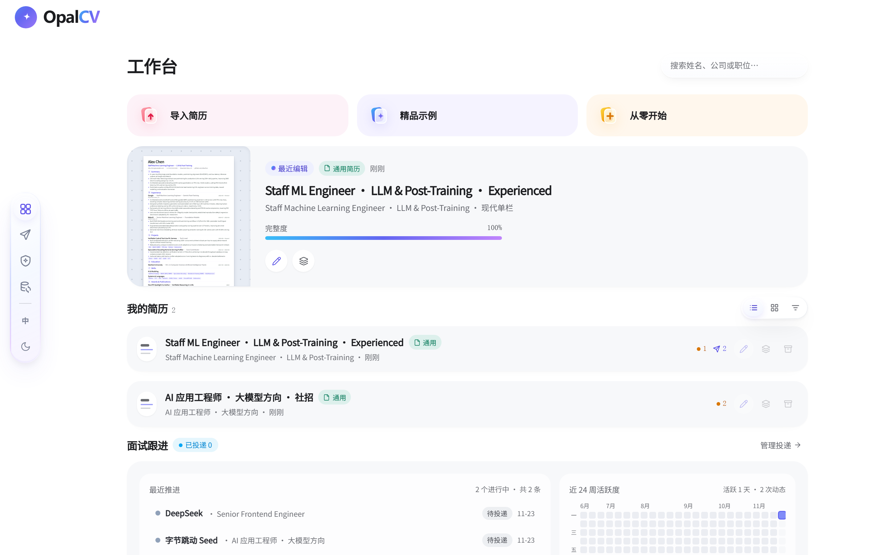
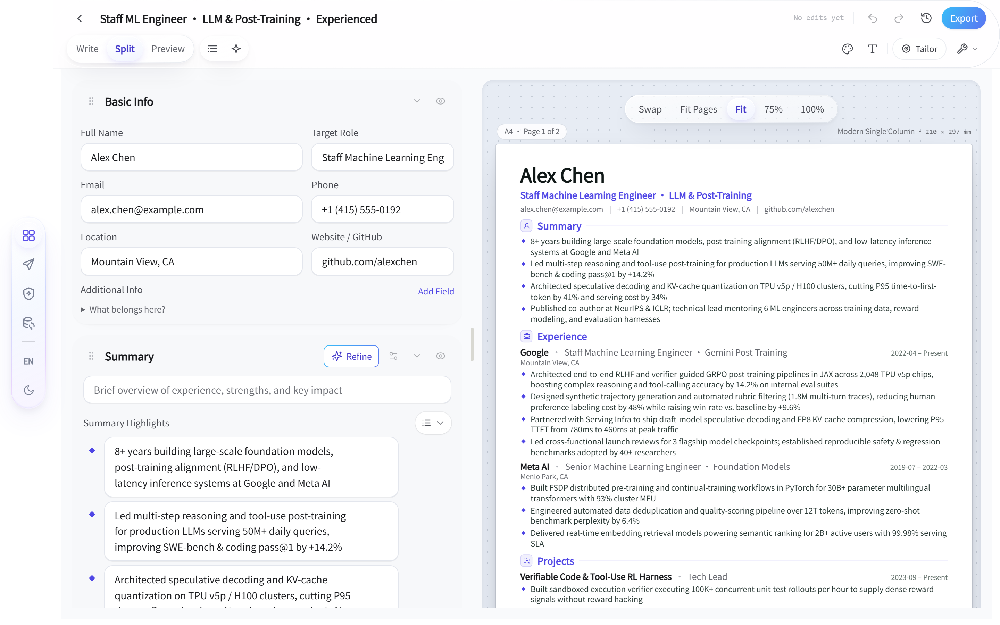
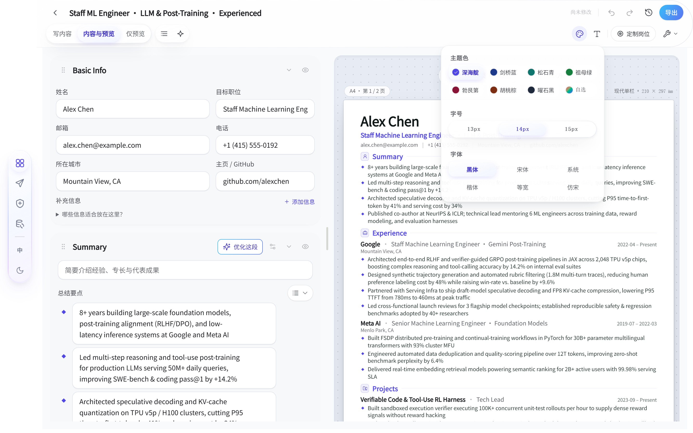
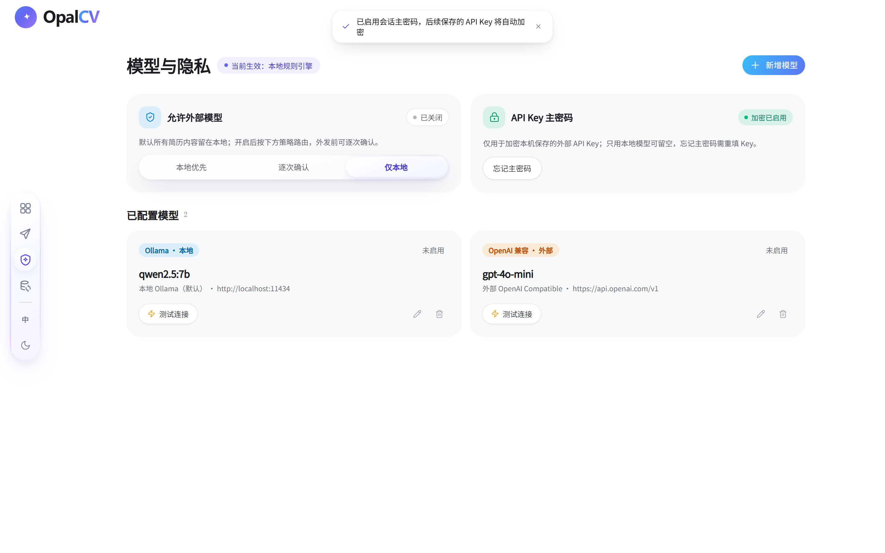
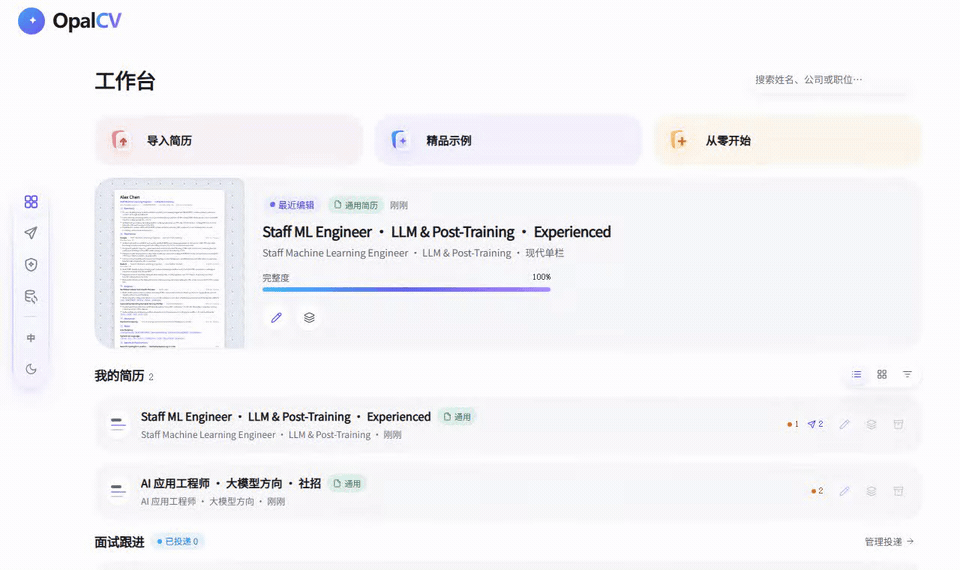
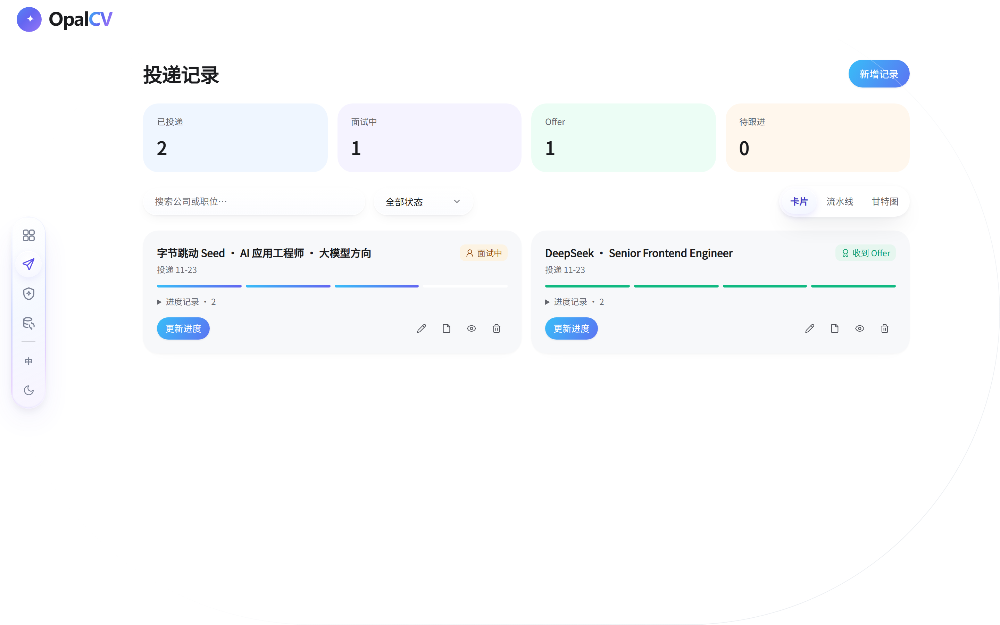
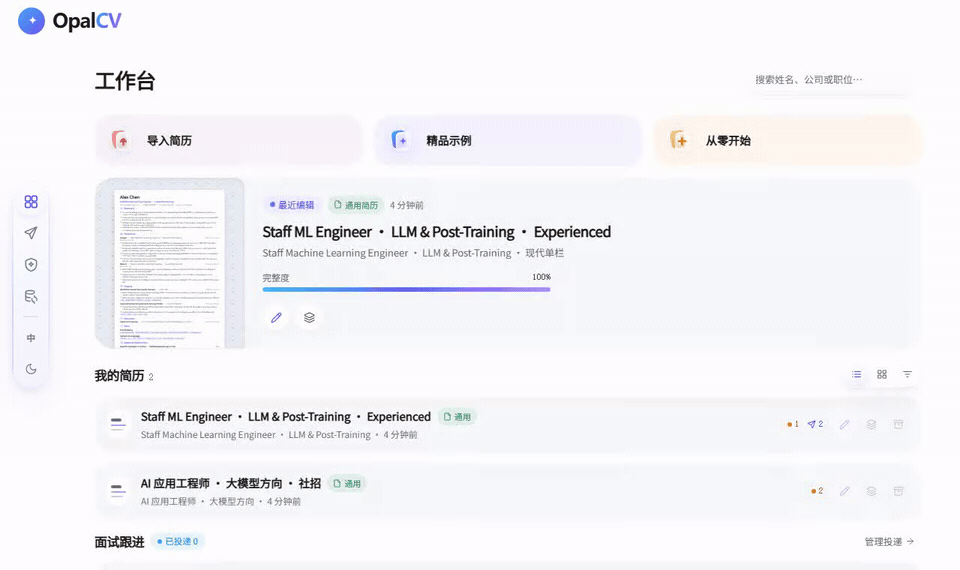

<div align="center">
  
  <h1>OpalCV</h1>
  <p>
    <strong>Craft your story into brilliance, locally.</strong><br/>
    A local-first, privacy-first, open-source AI resume studio.
  </p>

  <p>
    <strong>English</strong> · <a href="./README.zh-CN.md">简体中文</a> · <a href="https://beta-zheng.github.io/OpalCV/"><strong>🚀 Live Demo</strong></a>
  </p>

  <p>
    
    
    
    
    
  </p>

  <br/>
  
</div>

---

## ✨ Why OpalCV?

Your resume is some of your most personal data — yet most online resume builders require uploading it to third-party servers, lock PDF exports behind monthly subscriptions, or overwrite your experience with generic AI fluff.

**OpalCV** is built around **Local-First & Privacy-First** principles, giving you an end-to-end job search studio right in your browser:

- **🔒 100% Local-First & Zero Backend**: All resumes, version snapshots, job applications, and settings live in your browser's `IndexedDB`. Export/import full JSON backups anytime, or enable optional **AES-GCM end-to-end encrypted sync** (WebDAV / private GitHub Gist).
- **🛡️ Clear AI Privacy Boundaries**: Runs on a built-in local rules engine or your local **Ollama** instance by default. External OpenAI-compatible APIs (DeepSeek, OpenAI, etc.) are strictly opt-in behind an explicit risk confirmation dialog, with optional **local passphrase encryption (Web Crypto AES-GCM)** for stored API keys.
- **🎯 Master Resume → Tailored Versions + Inline Diffs**: Keep one master resume and branch tailored versions for each JD. AI polish and JD-matching suggestions appear as line-by-line diffs — you approve or reject every single edit.
- **📄 WYSIWYG Split Editor & Free Client-Side Export**: Multiple curated A4 templates for English and Chinese, floating Liquid Glass **Style / Layout** controls, one-click 1-page fit, and clean client-side **PDF / DOCX / Markdown** export with zero watermarks or paywalls.
- **🎆 Built-In Application & Interview Tracker**: Link every application to the exact resume snapshot you sent, switch across Cards / Pipeline / Timeline views, and celebrate every interview milestone with confetti fireworks and bilingual encouragement.

---

## 🖼️ Showcase

### Workbench — Light (ZH) & Dark (EN)

| English Workbench (Dark Mode) | 中文工作台（浅色液态玻璃） |
| :---: | :---: |
|  |  |

### Live Split Editor & Floating Style Controls

| English Split Editor | Floating Appearance Popover |
| :---: | :---: |
|  |  |

### Privacy-First AI & Local AES-GCM Vault

| Models & Privacy Control Center | Red Risk Guardrail & Local Passphrase Encryption |
| :---: | :---: |
|  |  |

### Application Tracker & Milestone Fireworks

| Application Board | Interview Progress Fireworks & Cheer |
| :---: | :---: |
|  |  |

---

## 🚀 Quick Start

Requirements: **Node.js >= 20** and **pnpm**

```bash
# 1. Install dependencies
pnpm install

# 2. Start the local dev server
pnpm dev

# 3. Run unit tests
pnpm test

# 4. Build static production assets (output to dist/)
pnpm build
```

The production build outputs pure static files that can be hosted anywhere (**GitHub Pages, Cloudflare Pages, Vercel**, or any static file server).

---

## 🧭 Workflow

1. **Create or Import**: On the **Workspace**, click `Import Resume` (drag & drop `PDF / DOCX / Markdown / TXT`), `Curated Samples` (instant English or Chinese AI examples), or `Start from Scratch`.
2. **Edit & Style Live**: Switch freely between `Write / Split / Preview`, use `Ctrl+Z` / `Ctrl+Shift+Z` to undo/redo, tweak templates, accent colors, fonts, and density from the floating **Style / Layout** popovers, or click **Tailor** to branch a JD-specific version.
3. **Connect AI (Optional)**: Open **Models & Privacy** to connect local Ollama or an OpenAI-compatible API. Optionally set a local master passphrase to encrypt saved API keys with Web Crypto AES-GCM.
4. **Export & Track**: Click **Export** for print-ready PDF, DOCX, or Markdown. Head to **Applications** to pin exported snapshots and track every interview round across Cards, Pipeline, and Gantt views.
5. **Backup & Sync**: Use **Data Management** to export/restore full JSON backups or set up encrypted WebDAV / private GitHub Gist sync.

---

## 🔄 Encrypted Cloud Sync (Optional)

All edits auto-save locally to `IndexedDB`. Cloud sync is **manual and end-to-end encrypted (Web Crypto AES-GCM)** in your browser before upload — tokens and sync passphrases stay in memory only and are never written to disk.

- **GitHub Secret Gist**:
  1. Generate a GitHub Personal Access Token — either a **Classic PAT** with only the `gist` scope, or a **Fine-grained PAT** with `Account permissions → Gists: Read and write`.
  2. Open **Data Management → Encrypted Sync → GitHub Gist**, paste your token, leave **Gist ID** empty on first upload (auto-creates a private `opalcv-backup.enc.json`), set a sync passphrase, and click **Encrypt & Upload**.
  3. On another device, enter your token, the saved **Gist ID**, and the same passphrase, then click **Download & Restore**.
- **WebDAV**: Point to any standard WebDAV URL with your credentials and sync passphrase using the same AES-GCM client-side encryption.

---

## 🛠️ Tech Stack

- **Frontend**: React 18 · TypeScript 5.7 · Vite 6 · Tailwind CSS 4 · Framer Motion
- **State & Storage**: Zustand · IndexedDB · Web Crypto API (AES-GCM)
- **Documents & Export**: `pdfjs-dist` · `mammoth` · `jszip` · Pure client-side PDF / DOCX / Markdown engine
- **Testing**: Vitest · Playwright

---

## 📄 License

Open-sourced under the [MIT License](./LICENSE). Stars, issues, and PRs are always welcome!
