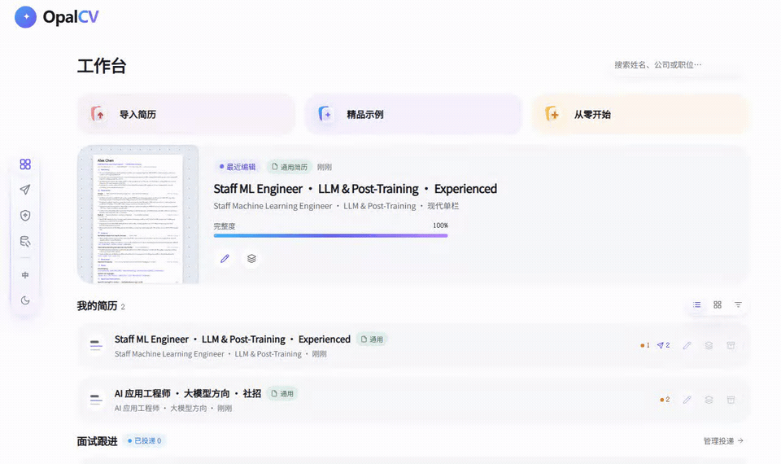
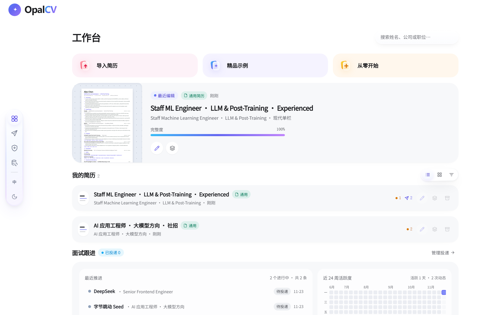
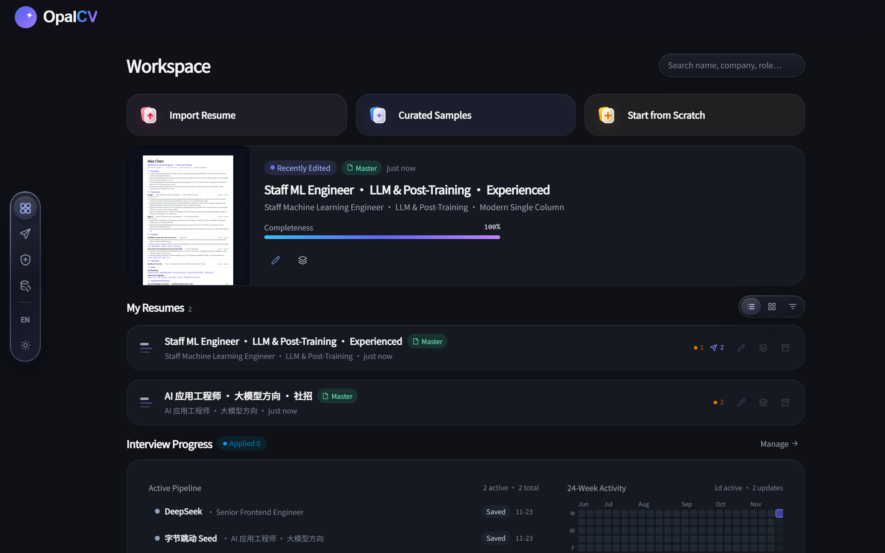
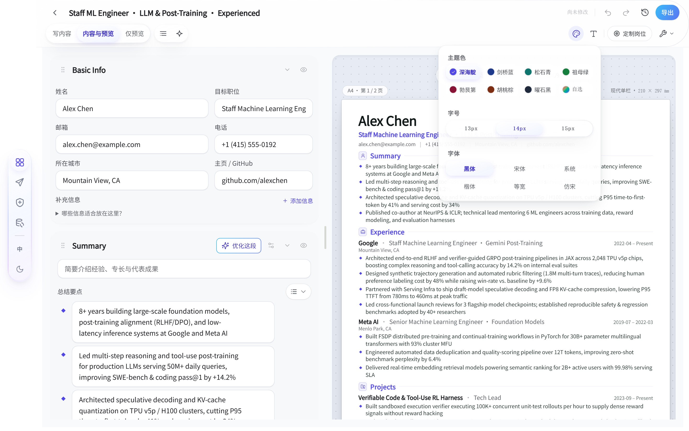
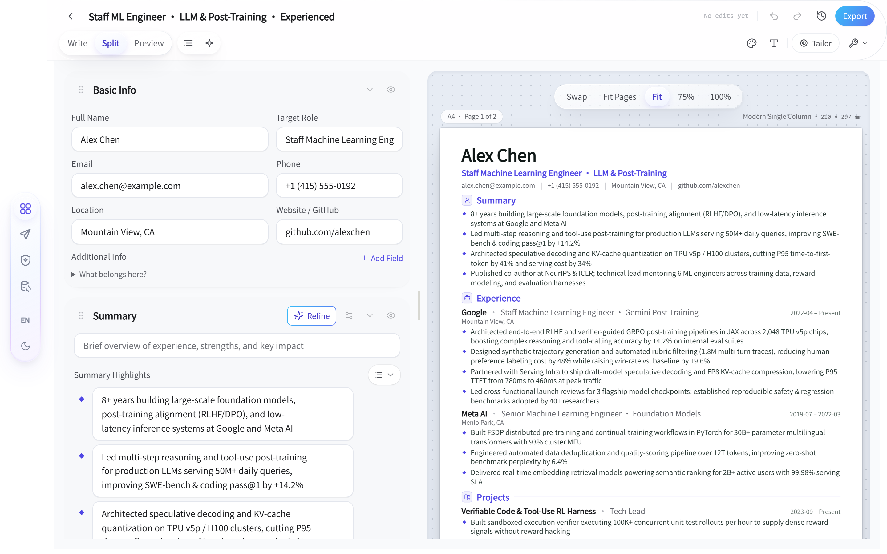
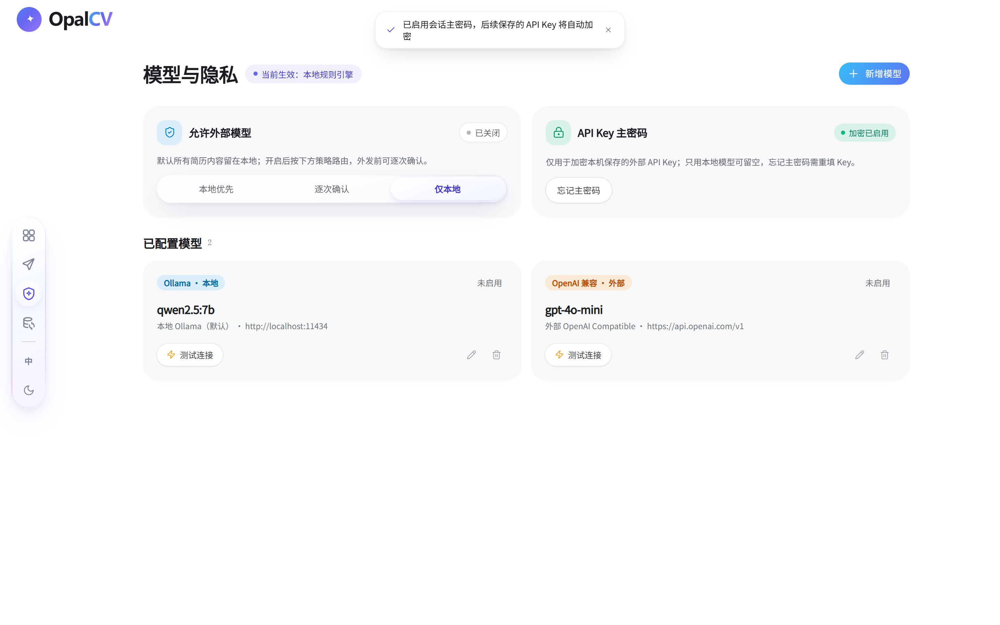
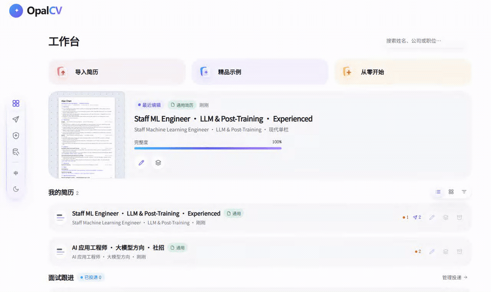
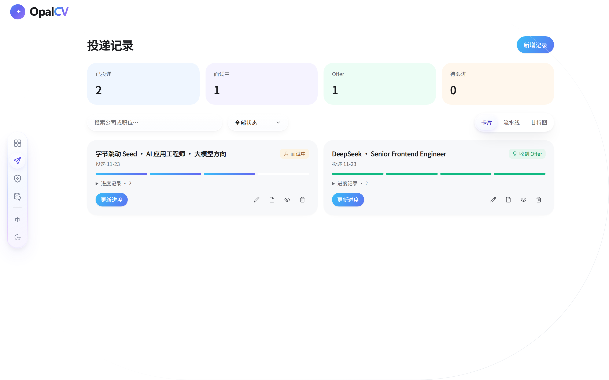
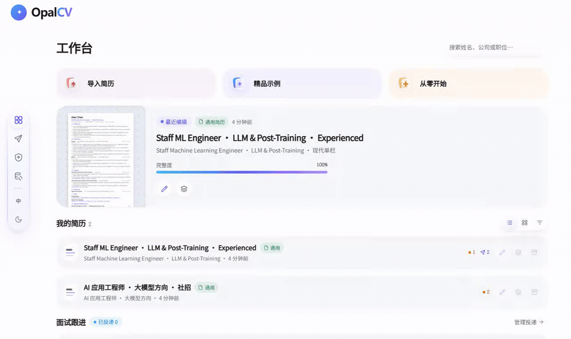

<div align="center">
  
  <h1>OpalCV · 欧泊简历</h1>
  <p>
    <strong>Craft your story into brilliance, locally.</strong><br/>
    把经历，打磨成光 —— 本地优先、隐私可控的开源 AI 简历工作台
  </p>

  <p>
    <a href="./README.md">English</a> · <strong>简体中文</strong>
  </p>

  <p>
    
    
    
    
    
  </p>

  <br/>
  
</div>

---

## ✨ 为什么选择 OpalCV？

写简历是最私密的数据场景之一，但市面上大多数在线简历工具往往要求上传个人履历、将高清导出与多版本管理锁进付费墙，或用 AI 一键覆盖你的真实经历。

**OpalCV** 以 **本地优先 & 隐私优先** 为核心原则，在浏览器内提供从简历创作、岗位定制到投递面试追踪的完整求职工作台：

- **🔒 100% 本地优先，零后端零上传**：所有简历、版本快照、投递记录与配置均保存在浏览器本地（`IndexedDB`），随时支持一键 JSON 备份恢复与 **AES-GCM 端到端加密同步**（WebDAV / GitHub 私有 Gist）。
- **🛡️ 隐私边界清晰可控**：默认仅使用本地规则引擎或本机 **Ollama**；外部 OpenAI 兼容模型（DeepSeek / OpenAI 等）需显式开启并经红色风险二次确认，支持用**本地主密码（Web Crypto AES-GCM）**加密保存 API Key。
- **🎯 一母多版 + Diff 级 AI 辅助**：维护一份主简历，按不同岗位 JD 派生专属版本；AI 润色与匹配建议以逐条对比（Diff）呈现，采纳或拒绝完全由你掌控。
- **📄 沉浸双栏排版 · 纯客户端无水印导出**：内置多套中英文 A4 专业模板，悬浮「外观 / 排版」液态玻璃面板实时微调主题色、字体与密度，支持智能一页适配与高清 **PDF / DOCX / Markdown** 本地导出。
- **🎆 投递闭环**：内置投递记录（卡片 / 流水线 / 甘特图），自动关联导出快照。

---

## 🖼️ 界面与动效预览

### 工作台 · 浅色中文 / 深色英文

| 中文工作台（浅色液态玻璃） | English Workbench（深色模式） |
| :---: | :---: |
|  |  |

### 双栏编辑器 · 悬浮外观面板 & 英文简历

| 双栏编辑 + 悬浮外观面板 | English Split Editor |
| :---: | :---: |
|  |  |

### 模型与隐私保护（Local-First & AES-GCM 主密码）

| 模型与隐私配置页 | 红色风险确认 & 本地主密码加密演示 |
| :---: | :---: |
|  |  |

### 投递记录与面试庆祝

| 投递进度看板 | 面试推进烟花与鼓励演示 |
| :---: | :---: |
|  |  |

---

## 🚀 快速开始

环境要求：**Node.js >= 20**、**pnpm**

```bash
# 1. 安装依赖
pnpm install

# 2. 启动本地开发服务器
pnpm dev

# 3. 运行单元测试
pnpm test

# 4. 构建生产静态产物（输出至 dist/）
pnpm build
```

构建产物为纯静态文件，可直接部署至 **GitHub Pages、Cloudflare Pages、Vercel** 或任意静态服务器。

---

## 🧭 使用指南

1. **创建或导入简历**：在 **工作台** 点击 `导入简历`（支持拖入 `PDF / DOCX / Markdown / TXT` 自动解析）、`精品示例`（一键载入中/英文 AI 示例）或 `从零开始`。
2. **双栏沉浸编辑与排版**：自由切换 `写内容 / 内容与预览 / 仅预览`，使用 `Ctrl+Z` / `Ctrl+Shift+Z` 撤销重做；通过顶部悬浮 **外观 / 排版** 面板实时调整模板、主题色、字体、字号与页边距，或点击 **定制岗位** 结合 JD 派生专属版本。
3. **配置 AI 模型（可选）**：前往 **模型与隐私** 接入本机 Ollama 或自定义 OpenAI 兼容 API；如需保护本机保存的外部 API Key，可设置本地主密码开启 AES-GCM 加密。
4. **导出与投递追踪**：点击 **导出** 生成打印级 PDF、DOCX 或 Markdown；前往 **投递记录** 绑定简历快照，在卡片 / 流水线 / 甘特视图中持续跟进每一轮面试。
5. **数据管理与迁移**：在 **数据管理** 中随时一键备份 / 恢复全量 JSON 数据，或配置 WebDAV / GitHub 私有 Gist 端到端加密同步。

---

## 🛠️ 技术栈

- **前端框架**：React 18 · TypeScript 5.7 · Vite 6 · Tailwind CSS 4 · Framer Motion
- **状态与存储**：Zustand · IndexedDB · Web Crypto API (AES-GCM)
- **文档解析与导出**：`pdfjs-dist` · `mammoth` · `jszip` · 纯客户端 PDF / DOCX / Markdown 导出引擎
- **测试体系**：Vitest · Playwright

---

## 📄 开源协议

本项目基于 [MIT License](./LICENSE) 开源，欢迎 Star、Fork、提 Issue 或 PR！
